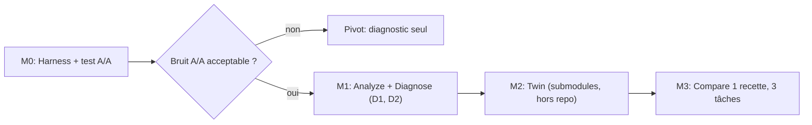

# Revue critique — SPEC-001 (Architecture MVP RepoTwin)

**Relecteur :** Claude Opus 5.5 (via Antigravity)  
**Date :** 23 octobre 2026  
**Verdict global :** Bonne ossature, mais **pas prête pour l'implémentation**. Trois défauts bloquants (statistiques, isolation, submodules) et une forte sous-spécification du cœur de valeur (tâches + oracle de réussite).

> [!NOTE]
> Plusieurs points ci-dessous ont été **vérifiés directement sur `nicehub-platform`** (marqués ✅ vérifié). Les autres sont des analyses de conception.

---

## 0. Corrections sur les échanges précédents

Avant la spec elle-même, quelques affirmations faites plus tôt dans la conversation méritent d'être nuancées :

- **« Le terrain est complètement vierge / vrai moat »** : non vérifié. Aucune recherche concurrentielle n'a été faite. Le RFC v0.2 avait raison d'être prudent ; à garder ainsi.
- **`aider --analytics`** : ce flag concerne la télémétrie d'Aider, pas un export de tokens. La spec §3.4 doit être corrigée.
- **Chiffres (étoiles GitHub, coûts par run)** : ordres de grandeur non sourcés, à ne pas reprendre dans un document.

---

## 1. Défauts bloquants

### B1. Le moteur statistique est mathématiquement incohérent

§3.4 : *« N ≥ 3 runs … Gain Validé avec p < 0.05 »*.

Avec 3 runs par bras, un test non paramétrique (Mann-Whitney) ne peut **jamais** descendre sous p = 0,10 en bilatéral (20 permutations possibles). Un t-test sur n=3 suppose une normalité invérifiable avec des distributions de tokens typiquement asymétriques (queues longues quand l'agent part en boucle).

**Recommandation :**
1. **Test A/A d'abord** : lancer Baseline contre Baseline (N runs chacun) pour mesurer le bruit propre. C'est **la** mesure go/no-go du projet : si le bruit A/A est de ±40 %, un gain de 10-20 % est indétectable à un N raisonnable.
2. Remplacer la p-value par une **taille d'effet + intervalle de confiance bootstrap** sur la médiane, avec N fixé à l'avance (pré-enregistré) à partir de la variance A/A.
3. Verdict à 3 états basé sur l'IC : IC entièrement sous 0 → gain ; contient 0 → non concluant ; au-dessus → régression.

### B2. Les worktrees sont créés *à l'intérieur* du dépôt analysé

§3.3 : `.repotwin/worktrees/candidate-<hash>/`.

Conséquence : quand l'agent tourne sur la Baseline, un `grep`/`glob` récursif **trouve aussi les fichiers de la Candidate** (et des runs précédents). Contamination directe des mesures de navigation et de tokens, plus des doublons d'indexation pour les outils de l'IDE.

**Recommandation :** worktrees **hors du dépôt** (ex. `~/.cache/repotwin/<repo-id>/<run-id>/`), et **Baseline aussi en worktree neuf** depuis le même commit. La CLI actuelle (`--baseline=main`) ferait tourner la Baseline dans la copie de travail de l'utilisateur, avec ses fichiers non commités, ses `node_modules` et son état : asymétrie garantie.

### B3. `git worktree` ne gère pas les submodules (✅ vérifié — fatal sur NiceHub)

`nicehub-platform` déclare **4 submodules** (`backend`, `frontend`, `mobile`, `flutter`) dans `.gitmodules`. Un `git worktree add` crée ces dossiers **vides** tant qu'on ne lance pas `git submodule update --init` dans le worktree (et les modifs de la Candidate dans un submodule exigent alors une branche *dans* ce submodule).

Même cause, autre effet : `git ls-files` à la racine (Niveau 1 du Diagnose) **ne liste pas les fichiers des submodules**, donc tout chemin sous `backend/` serait faussement jugé absent.

**Recommandation :** support explicite des submodules dès le MVP (`--recurse-submodules`, `git -C <sub> ls-files`), ou choisir le pilote sur **un seul sous-dépôt** (ex. `backend` seul) pour la v0.

---

## 2. Défauts majeurs

### M1. Le cœur de la valeur n'est pas spécifié : la tâche et son oracle

`--task=tasks/add-field.json` est cité mais son format n'existe pas. Or c'est ce qui décide si « tokens par tâche réussie » a un sens. Il faut définir :

```yaml
id: add-ride-field
base_commit: <sha>          # point de départ figé
prompt: "..."               # identique pour les deux bras
setup: ["npm ci"]           # par worktree
verify:                     # oracle CACHÉ, appliqué APRÈS le run
  apply_patch: tests/hidden/add-ride-field.test.js
  command: "npm test -- add-ride-field"
timeout_s: 900
budget_usd: 2.00
```

Points clés :
- **Oracle caché** (style SWE-bench) : sinon l'agent peut modifier ou supprimer les tests pour « réussir ».
- `test_passed: boolean` ne suffit pas : distinguer *tâche réussie* (oracle) et *non-régression* (suite existante).
- NiceHub n'a **pas de commande de test racine** : les tâches pilotes doivent viser un sous-projet qui a des tests (`backend/__tests__` existe ✅ vérifié).

### M2. Métrique de décision : tokens bruts vs coût, et taux de réussite

- La règle « `Tokens Candidate < Tokens Baseline` » ignore une différence de taux de réussite. Il faut **d'abord** filtrer sur la réussite (non-infériorité), **puis** comparer le coût par tâche réussie.
- Additionner input + output + cache n'a pas de sens économique : les tokens lus depuis le cache coûtent bien moins cher. Utiliser le **coût** (`total_cost_usd`) comme métrique primaire, les tokens comme métriques explicatives.

### M3. Biais de cache et d'environnement de l'agent

Claude Code charge, en plus du dépôt : la mémoire globale `~/.claude/CLAUDE.md`, les settings user, les serveurs MCP configurés, les plugins et l'historique de projet. Le prompt cache côté API crée aussi un **effet d'ordre** (le second run profite du cache du premier).

**Recommandation pour le runner :**
- `--setting-sources project`, `--strict-mcp-config` avec une config vide, `--model <nom complet épinglé>` (jamais d'alias `opus`/`sonnet`).
- `HOME` temporaire isolé par run si nécessaire.
- **Ordre des runs entrelacé et randomisé** (ABBA…), jamais tous les A puis tous les B.
- Récupération via `--output-format stream-json` pour compter les appels d'outils et les fichiers lus (le JSON final seul ne donne pas `files_explored`).

### M4. Sécurité : « désactivé » n'est pas un mécanisme (✅ vérifié — urgent)

La spec dit que les actions sur paiements/DB/prod sont « désactivées ou sécurisées » sans dire comment. Sur NiceHub :
- `.env.stripe.live` est présent à la racine (non tracké, donc absent d'un worktree neuf — bien).
- Mais le submodule `backend` **tracke** `AuthKey_83KZYQKQUW.p8` (clé privée Apple) et `.env.temp`. Ils seront copiés dans chaque worktree, et donc lisibles par l'agent.
- Le dossier contient des scripts destructifs (`delete_driver_by_id.js`, `clear_stripe_ids*.js`…) qu'un agent autonome peut exécuter.

**Recommandation :** sandbox réelle pour la phase Compare (conteneur sans réseau ou avec allowlist vers l'API du modèle seulement), jamais `--dangerously-skip-permissions` hors sandbox, et un « secret scan » bloquant avant la création du twin.

---

## 3. Diagnose Engine — l'algorithme a des trous

### D1. L'heuristique « contient un point → colonne SQL » est fausse

`lib/api.ts`, `payment.js`, `.env`, `073_b2b_providers_v1.sql` contiennent tous un point. Il faut un classifieur ordonné :
1. Extension de fichier connue → candidat fichier.
2. Glob/wildcard (`t.admin.*`) → clé i18n / motif, pas un chemin.
3. `ident.ident` sans extension **et** `ident` = table connue → colonne DB.
4. Sinon → « inconnu », confiance basse, **pas d'action automatique**.

### D2. Le vrai faux positif dominant n'est pas traité : la portée des règles (✅ vérifié)

`.cursor/rules/backend-api.mdc` déclare `globs: backend/src/**/*` et référence `src/middleware/auth.js`. Ce fichier **existe** dans `backend/src/middleware/auth.js`. `agent-ready` l'a signalé comme obsolète parce qu'il résout depuis la racine.

C'est probablement la majorité des 22 alertes « stale-path » de NiceHub. Il faut un **Niveau 1bis** : résoudre chaque chemin relativement à (a) la racine, (b) la racine déduite des `globs` de la règle, (c) chaque racine de sous-projet, (d) une recherche par nom de fichier (`073_b2b_providers_v1.sql` existe sûrement dans un dossier `migrations/`).

Ce point est **plus précieux** que la détection SQL pour démontrer la valeur de RepoTwin face à `agent-ready`.

### D3. La « canonisation des règles » peut dégrader Cursor

Les `.mdc` avec `globs` + `alwaysApply: false` sont **attachées seulement quand c'est pertinent**. Les remplacer par un pointeur vers un `AGENTS.md` monolithique peut **augmenter** le contexte chargé à chaque tâche. C'est exactement le genre d'optimisation à **tester**, pas à appliquer par défaut. Le §3.3 la présente comme une recette sûre : à reformuler en hypothèse.

### D4. Niveau 4 (similarité) non défini

« Similarité textuelle / sémantique » sans algorithme ni seuil. Pour le MVP : shingling + Jaccard sur des paragraphes normalisés, seuil configurable. Pas d'embeddings (dépendance réseau, coût, non déterminisme).

---

## 4. Incohérences et éléments à retirer

| Élément | Problème | Action |
|---|---|---|
| `readinessScoreEstimated` | Contredit la thèse du RFC (« le score n'est pas une preuve ») | Supprimer |
| Tree-sitter (schéma §2) | Absent de la stack, inutile au MVP 1 | Retirer du MVP |
| Aider + Claude Code | Deux runners = deux formats de métriques | Claude Code seul en v0 (installé localement ✅) |
| Recettes Twin | Qui rédige le nouveau `AGENTS.md` ? Template ou LLM ? | Spécifier. Template déterministe d'abord |
| Ingestion du rapport Markdown agent-ready | Parsing de tableau Markdown fragile | Préférer une sortie JSON si l'outil en propose une, Markdown en secours |
| Dépendances par worktree | `node_modules` absents dans un worktree neuf | Étape `setup` explicite, mesurée à part, hors coût agent |

---

## 5. Séquencement recommandé



**Changement clé :** commencer par le **harnais de mesure et un test A/A sur `backend` seul**, avant le scanner. C'est l'hypothèse la plus risquée du projet et la moins coûteuse à tester (aucune recette d'optimisation n'est nécessaire). Le scanner est utile mais peu risqué ; le benchmark est ce qui décide go/pivot/no-go.

---

## 6. Points à trancher par le porteur

1. Pilote sur **NiceHub complet** (submodules à gérer dès v0) ou **`backend` seul** ?
2. Budget maximal du test A/A (ex. 20 runs × coût unitaire) ?
3. Métrique primaire : **coût USD par tâche réussie** (recommandé) ou tokens totaux ?
4. Sandbox : Docker local acceptable comme prérequis du MVP 3 ?
