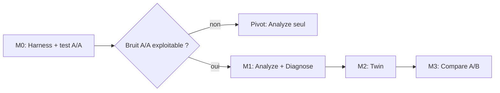

# RepoTwin — SPEC 001 : Architecture Technique & Spécifications MVP

**Version :** 1.1  
**Date :** 23 octobre 2026  
**Statut :** Spécification révisée, prête pour implémentation de M0  
**Références :** [RFC-001-RepoTwin-v0.2.md](file:///Users/hmannai/Downloads/repotwin/RFC-001-RepoTwin-v0.2.md) · [REVIEW-SPEC-001.md](file:///Users/hmannai/Downloads/repotwin/REVIEW-SPEC-001.md)

---

## 0. Décisions actées (23/10/2026)

| # | Sujet | Décision | Conséquence technique |
|---|---|---|---|
| D1 | Périmètre d'entrée | **Un dépôt quelconque en entrée → un rapport en sortie.** Pilote : NiceHub complet. | Support des **submodules Git dès la v0** (NiceHub en a 4). |
| D2 | Rigueur du test | Test A/A **à la hauteur de l'enjeu** : c'est la preuve fondatrice de l'outil. | 3 tâches × 2 bras × 10 runs, budget plafonné après calibration (§5.4). |
| D3 | Métrique primaire | **Coût USD par tâche réussie.** | Tokens = métriques explicatives. Taux de réussite = garde-fou. |
| D4 | Sandbox | **Docker local** (installé, v24.0.5). | Vercel écarté : serverless, timeouts, pas de disque persistant ni de Git. GitHub Actions = option ultérieure pour la CI. |

---

## 1. Objectif

RepoTwin prend un dépôt Git local et produit :
1. un **diagnostic** de ce qui gêne les agents IA, avec preuves et niveau de confiance ;
2. une **variante optimisée** isolée (le *twin*) ;
3. un **verdict mesuré** : l'optimisation réduit-elle le coût par tâche réussie, sans dégrader la qualité ?

---

## 2. Jalons (ordre imposé par le risque)



| Jalon | Livrable | Critère de sortie |
|---|---|---|
| **M0** | Runner Docker + Claude Code, format de tâche, oracle caché, test A/A | Bruit A/A mesuré ; N et taille d'effet minimale détectable connus |
| **M1** | `repotwin analyze` | Requalifie correctement les alertes `agent-ready` de NiceHub, vérifiées à la main |
| **M2** | `repotwin twin create/clean` | Twin avec submodules, diff inspectable, nettoyage sans résidu |
| **M3** | `repotwin compare` | Verdict A/B sur 1 recette × 3 tâches |

> [!IMPORTANT]
> M0 passe en premier : c'est l'hypothèse la plus risquée et elle ne dépend d'aucune recette d'optimisation. Si l'agent est trop bruité pour mesurer un écart de 20 %, la partie Compare n'a pas de sens et on pivote.

---

## 3. Architecture

```text
repotwin (CLI, Node 20+, TypeScript ESM)
├── analyzer/    découverte des sous-projets, instructions agents, import agent-ready
├── diagnostics/ classification des constats, résolution de portée
├── twin/        worktrees hors dépôt, submodules, recettes, nettoyage
├── runner/      exécution Claude Code dans Docker, collecte stream-json
├── compare/     orchestration A/A et A/B, bootstrap, verdict
└── report/      sortie JSON + Markdown
```

Espace de travail, **toujours hors du dépôt analysé** :

```text
~/.cache/repotwin/<repo-id>/
├── runs/<run-id>/
│   ├── baseline/     worktree neuf depuis base_commit
│   ├── candidate/    worktree neuf + recette appliquée
│   └── logs/         stream-json, sortie de l'oracle, metrics.json
└── reports/
```

---

## 4. Modules

### 4.1 Analyze (`src/analyzer/`)

- **Découverte des sous-projets** : `.gitmodules` en priorité, puis recherche de `package.json`, `pubspec.yaml`, `pyproject.toml`, `Cargo.toml`, `go.mod` (profondeur 3 par défaut, `node_modules`/`build`/`.git` exclus).
- **Commandes** : scripts `test`, `build`, `lint` par sous-projet.
- **Instructions agents** : `AGENTS.md`, `CLAUDE.md`, `GEMINI.md`, `.cursorrules`, `.cursor/rules/*.mdc` (avec frontmatter `globs` et `alwaysApply`), `.github/copilot-instructions.md`.
- **Inventaire des fichiers** : `git ls-files` à la racine **et** `git -C <submodule> ls-files` dans chaque submodule.
- **Import `agent-ready`** : JSON si disponible, sinon parsing du rapport Markdown (en secours, tolérant aux erreurs).

### 4.2 Diagnose (`src/diagnostics/`)

Classification ordonnée de chaque référence `R` signalée comme absente. On s'arrête au premier niveau qui conclut.

| Niveau | Test | Conclusion |
|---|---|---|
| 1 | `R` existe depuis la racine (inventaire submodules inclus) | Faux positif |
| **1bis** | `R` existe relativement à : la base des `globs` de la règle source, puis chaque racine de sous-projet | Faux positif « portée » ; correctif optionnel : préfixer le chemin |
| 1ter | Le **nom de fichier** de `R` existe ailleurs, une seule fois | Chemin incomplet ; correctif proposé avec le chemin trouvé |
| 2 | `R` commence par un alias (`@/`, `~/`…) résolu via `tsconfig`/`jsconfig`/`vite.config` | Faux positif alias |
| 3 | `R` contient un joker (`t.admin.*`) | Motif / clé i18n, pas un chemin |
| 4 | `R` = `ident.ident` **sans extension connue** et `ident` = table trouvée dans les migrations SQL | Référence de colonne DB |
| 5 | `R` est un fichier ignoré par Git (`.env`…) | Volontairement absent : pas d'action |
| — | Aucun niveau ne conclut | **Inconnu**, confiance basse, aucune action automatique |

**Doublons de règles** : shingling sur paragraphes normalisés + similarité de Jaccard, seuil configurable (défaut 0,6). Pas d'embeddings : il faut un résultat déterministe, sans réseau.

> [!WARNING]
> Remplacer des règles Cursor ciblées (`globs`, `alwaysApply: false`) par un pointeur vers un `AGENTS.md` unique peut **augmenter** le contexte chargé. C'est une **hypothèse à tester en M3**, jamais une correction appliquée par défaut.

### 4.3 Twin (`src/twin/`)

1. **Contrôle préalable bloquant** : scan des secrets suivis par Git (motifs `*.p8`, `*.pem`, `.env*` hors `*.example`, clés API connues), dans la racine et les submodules. S'il y en a, la commande s'arrête, sauf si `--allow-tracked-secrets` est passé explicitement. Dans ce cas, ces fichiers sont remplacés par des leurres dans les worktrees.
2. **Création** : `git worktree add --detach <cache>/runs/<id>/{baseline,candidate} <base_commit>`, puis `git submodule update --init --recursive` dans chaque worktree.
3. **Recettes** (déterministes, à partir de templates, sans LLM en v0) :
   - `fix-scoped-paths` : corrige les chemins classés 1bis/1ter.
   - `add-verification` : ajoute à `AGENTS.md` une section « Vérification » avec les commandes découvertes.
   - `add-safety` : ajoute une section « Limites de sécurité » (scripts destructifs détectés, secrets, prod).
   - `unify-rules` : expérimentale, uniquement en A/B.
4. **Modifications dans un submodule** : branche locale `repotwin/<run-id>` dans le submodule du worktree candidat. Rien n'est poussé.
5. **Nettoyage** : `git worktree remove --force` + `git worktree prune` + suppression des branches `repotwin/*`, y compris dans les submodules.

### 4.4 Runner (`src/runner/`)

**Agent unique en v0 : Claude Code CLI.**

```bash
claude -p "<prompt>" \
  --output-format stream-json --verbose \
  --model <nom-complet-épinglé> \
  --setting-sources project \
  --strict-mcp-config --mcp-config '{"mcpServers":{}}' \
  --permission-mode acceptEdits \
  --allowedTools "Read,Edit,Write,Glob,Grep,Bash(npm test:*),Bash(npm run:*)"
```

- **Isolation** : conteneur Docker par run, worktree monté en `/work`, `HOME` jetable, réseau limité à l'API Anthropic (proxy en liste blanche). `--dangerously-skip-permissions` n'est autorisé **que** dans ce conteneur.
- **Authentification** : `ANTHROPIC_API_KEY` passée au conteneur. *Prérequis : la CLI locale renvoie actuellement « Invalid API key ».*
- **Collecte** (depuis le stream-json) : coût, tokens d'entrée, de sortie, de lecture et d'écriture de cache, nombre de tours, appels d'outils par type, chemins distincts lus, durée.
- **Limites** : timeout par tâche, et arrêt du run si le coût cumulé dépasse `budget_usd`.

### 4.5 Compare (`src/compare/`)

**Format de tâche** (`tasks/<id>.yaml`) :

```yaml
id: add-ride-field
repo_subpath: backend          # sous-projet visé (facultatif)
base_commit: <sha>
prompt: "..."                  # identique dans les deux bras
setup: ["npm ci"]              # hors mesure agent
oracle:                        # caché à l'agent, appliqué APRÈS le run
  patch: oracles/add-ride-field.test.js
  command: "npm test -- add-ride-field"
regression: "npm test"
timeout_s: 900
budget_usd: 3.00
```

**Métriques par run** : `success` (oracle), `regression_ok`, `cost_usd`, tokens détaillés, `turns`, `tool_calls`, `files_read`, `duration_ms`.

**Protocole** :
- Ordre des runs **entrelacé et randomisé** (graine enregistrée).
- Worktrees neufs pour chaque run (aucun état partagé).
- Modèle épinglé, et version de la CLI enregistrée dans le rapport.

**Décision** :
1. **Garde-fou qualité** : le taux de réussite de la Candidate ne doit pas être inférieur à celui de la Baseline au-delà de la marge fixée (défaut : −1 run sur 10).
2. **Métrique primaire** : coût moyen par tâche réussie = `Σ cost_usd / nb_succès`.
3. **Intervalle** : bootstrap (10 000 rééchantillonnages) sur l'écart relatif, IC à 90 %.
4. **Verdict** : IC entièrement < 0 → `CONFIRMED_GAIN` ; contient 0 → `INCONCLUSIVE` ; garde-fou violé ou IC > 0 → `REGRESSION`.

---

## 5. Protocole M0 — Test A/A

### 5.1 But
Mesurer la variabilité propre de l'agent sur NiceHub, **sans aucune optimisation**, pour connaître l'écart minimal détectable.

### 5.2 Tâches
3 tâches NiceHub vérifiables par un oracle, de difficulté croissante, au moins une dans `backend` (qui a `__tests__`). Une tâche avec traversée de sous-projets est souhaitable, pour exercer la navigation.

### 5.3 Plan
3 tâches × 2 bras identiques × 10 runs = **60 runs**.

### 5.4 Budget
1. **Calibration** : 1 run par tâche (3 runs) → coût unitaire réel par tâche.
2. **Projection** : coût unitaire × 60 × 1,2 (marge).
3. **Plafond dur** : validé par le porteur après calibration. Valeur provisoire : **150 $**, arrêt automatique si elle est atteinte.

### 5.5 Sortie
Pour chaque tâche : distribution des coûts, taux de réussite, écart A/A et son IC, **effet minimal détectable** à N=10. Si cet effet dépasse 30 %, le verdict M0 est « pivot ».

---

## 6. Types principaux (`src/types/`)

```typescript
export type RefClass =
  | 'EXISTS' | 'SCOPE_RELATIVE' | 'INCOMPLETE_PATH' | 'ALIAS'
  | 'PATTERN' | 'DB_COLUMN' | 'GITIGNORED' | 'STALE' | 'UNKNOWN';

export interface Finding {
  id: string;
  source: 'agent-ready' | 'repotwin';
  rule: string;
  ref?: string;
  sourceFile: string;
  classification: RefClass | 'DUPLICATE_RULES' | 'MISSING_VERIFICATION' | 'MISSING_SAFETY';
  evidence: string[];
  confidence: number;           // 0..1
  suggestedFix?: { file: string; before: string; after: string };
}

export interface Subproject {
  path: string;
  isSubmodule: boolean;
  kind: 'node' | 'flutter' | 'python' | 'go' | 'rust' | 'unknown';
  commands: Partial<Record<'test' | 'build' | 'lint', string>>;
}

export interface RunMetrics {
  runId: string; taskId: string; arm: 'A' | 'B';
  success: boolean; regressionOk: boolean;
  costUsd: number;
  tokens: { input: number; output: number; cacheRead: number; cacheWrite: number };
  turns: number; toolCalls: number; filesRead: number; durationMs: number;
}

export interface Verdict {
  taskId: string; n: number;
  successRate: { a: number; b: number };
  costPerSuccess: { a: number; b: number };
  deltaPct: number; ci90: [number, number];
  result: 'CONFIRMED_GAIN' | 'INCONCLUSIVE' | 'REGRESSION';
}
```

---

## 7. CLI

```bash
repotwin analyze <repo> [--agent-ready <report>] [--json]
repotwin twin create <repo> --recipe <name> [--base <sha>]
repotwin twin clean <repo>
repotwin bench aa <repo> --tasks tasks/ --runs 10 --budget 150
repotwin bench ab <repo> --recipe <name> --tasks tasks/ --runs 10 --budget 150
```

---

## 8. Stack

Node 20+ (local : v25), TypeScript ESM, `commander`, `simple-git`, `zod`, `yaml`, `vitest`. Docker via la CLI `docker`, sans SDK. Tree-sitter est **hors MVP**.

---

## 9. Prérequis avant M0

- [ ] Clé API Anthropic valide (la CLI locale renvoie « Invalid API key »).
- [ ] Docker Desktop démarré (le daemon ne tourne pas actuellement).
- [ ] Révoquer et sortir du suivi Git `backend/AuthKey_83KZYQKQUW.p8` et `backend/.env.temp`.
- [ ] Choisir les 3 tâches pilotes NiceHub et écrire leurs oracles.

---

## Annexe — Changements depuis v1.0

- Ajout de M0 (harnais + A/A) avant le scanner.
- Worktrees hors dépôt, Baseline en worktree neuf, submodules pris en charge.
- Remplacement de « p < 0,05 avec N=3 » par un IC bootstrap + garde-fou sur la réussite.
- Métrique primaire : coût USD par tâche réussie.
- Classifieur Diagnose réordonné ; ajout de la résolution de portée (1bis/1ter).
- Format de tâche avec oracle caché.
- Runner Claude Code seul, isolé dans Docker ; Aider retiré.
- Suppression de `readinessScoreEstimated` et de Tree-sitter.
- Contrôle bloquant des secrets suivis avant création d'un twin.
